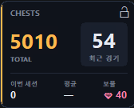
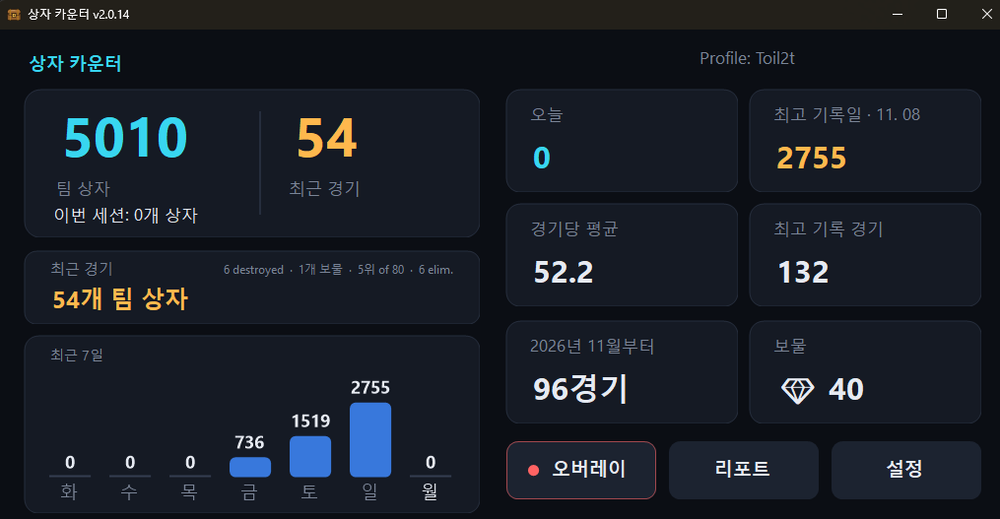
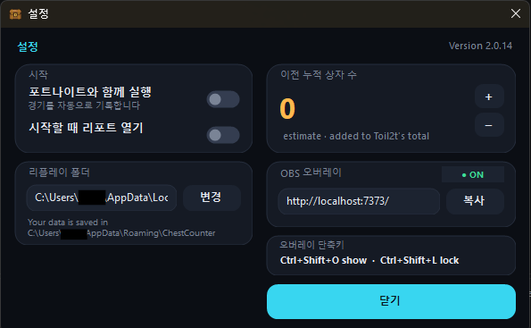
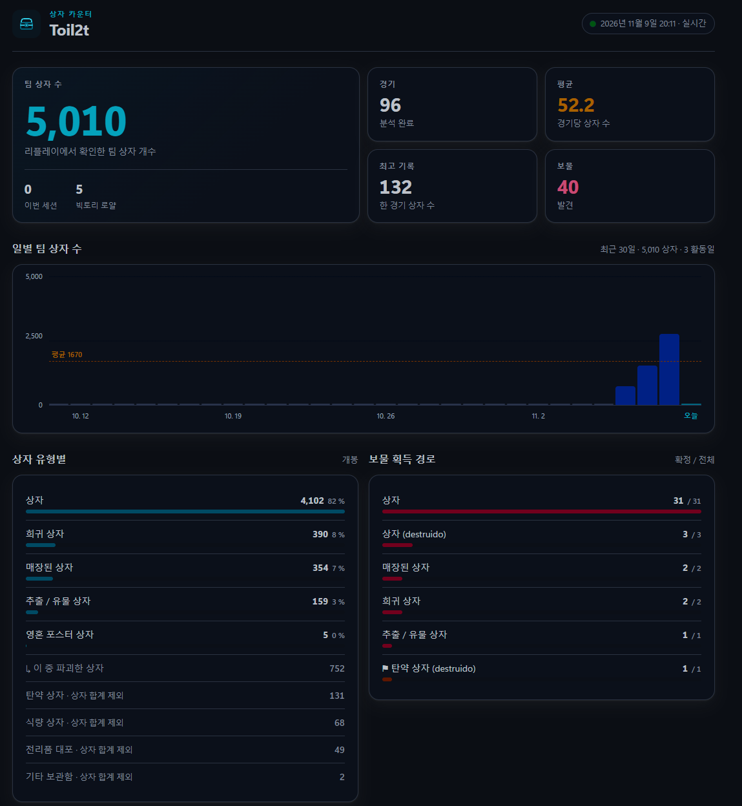

<div align="center">

[Español](README.es.md) · [English](README.en.md) · **한국어**

# 포트나이트 상자 카운터

[](../../releases/latest) [](../../releases)  [](LICENSE)

**포트나이트에서 연 상자를 경기마다 기록하고, 게임 화면 오버레이로 확인하세요.**

&nbsp;&nbsp;

[**⬇ ChestCounter.exe 다운로드**](../../releases/latest) · Windows 10 / 11 · 무료 · 설치 불필요

</div>

---

ChestCounter는 포트나이트가 경기 후 저장하는 리플레이를 읽어 **팀 전체가 연 상자 수**와 내가 획득한 **보물찾기 보상**을 기록합니다. 항상 위에 표시되는 오버레이로 플레이 중에도 합계를 확인할 수 있고, 상세 리포트에는 전체 기록이 보존됩니다.

> 나를 포함한 팀원 전체가 연 상자를 셉니다. 지도에 상자 위치를 표시하는 기능은 아닙니다.

## 주요 기능

- 💎 창, 오버레이, OBS에 보물 표시
- 최근 7일 상자 수 그래프와 경기별 통계
- 상자 유형별 통계 및 경기 기록 리포트
- 여러 계정의 기록을 프로필별로 분리
- OBS 브라우저 소스용 오버레이 제공

## 작동 방식과 안전성

포트나이트는 PC에서 플레이한 경기를 **리플레이 파일**로 저장할 수 있습니다. ChestCounter는 경기가 끝난 뒤 이 파일만 읽습니다.

- ✅ **리플레이 파일만 읽습니다.** `%LOCALAPPDATA%\FortniteGame\Saved\Demos`에 있는 `.replay` 파일을 읽기 전용으로 열며 수정하지 않습니다.
- ✅ **게임을 변경하지 않습니다.** 포트나이트 설치 폴더에 파일을 추가하거나 패치하지 않습니다.
- ✅ **게임 메모리에 접근하지 않습니다.** 포트나이트 프로세스의 메모리를 읽거나 쓰거나 코드를 삽입하지 않으며, 실행 중인 게임과 상호작용하지 않습니다.
- ✅ **외부 네트워크에 연결하지 않습니다.** 로그인, Epic 계정 접근, 원격 측정, GitHub 버전 확인이 없습니다. OBS 오버레이는 내 PC에서만 제공합니다.
- ✅ **가볍게 실행됩니다.** 낮은 우선순위로 동작하고 경기 사이에는 대기하며, 숫자가 바뀔 때만 오버레이를 다시 그립니다.

> [!IMPORTANT]
> **포트나이트에서 리플레이 녹화를 켜야 합니다.** *설정 → 게임 → 리플레이 → 리플레이 녹화: 켜기* (대규모 팀 모드도 플레이한다면 해당 옵션도 켜세요). 리플레이가 없으면 읽을 데이터가 없습니다.

포트나이트는 경기가 끝나야 리플레이 복호화 키를 기록하므로, 상자 수는 경기 도중이 아니라 **경기 종료 후 몇 초 뒤**에 집계됩니다. 경기 중에는 오버레이에 **● 경기 진행 중**으로 표시됩니다.

## 시작하기

1. **[`ChestCounter.exe`](../../releases/latest)를 다운로드**합니다. 실행 파일 하나면 충분합니다.
2. 포트나이트 설정에서 리플레이 녹화를 켭니다.
3. `ChestCounter.exe`를 실행합니다.
   > Windows에서 서명되지 않은 실행 파일이라 *"Windows의 PC 보호"*가 표시될 수 있습니다. *추가 정보 → 실행*을 선택하세요.
4. 간단한 초기 설정에서 리플레이 폴더를 확인하고, PC에 이미 있는 리플레이를 분석할지, 포트나이트가 시작될 때 카운터도 자동으로 열지 선택합니다. 앱 언어는 Windows 표시 언어를 따릅니다. **한국어 Windows에서는 한국어**, 스페인어 Windows에서는 스페인어, 그 외에는 영어로 표시됩니다.

<p align="center"></p>

기존 리플레이를 분석하면 창에 진행률이 표시됩니다. 분석 중에도 브라우저에서 리포트가 열리고 내용이 실시간으로 채워집니다.

5. 플레이하는 동안 창을 열어 둡니다. 최소화해도 됩니다. 경기가 끝나면 몇 초 후 상자 수가 추가됩니다.

<p align="center"></p>

> [!TIP]
> 포트나이트는 저장 가능한 리플레이 수에 제한이 있어 오래된 파일을 삭제합니다. 카운터가 꺼져 있을 때 진행한 경기는 집계되지 않습니다. 초기 설정에서 또는 설정 창에서 **포트나이트와 함께 실행**을 켜두면 매번 직접 실행할 필요가 없습니다.

## 포트나이트와 함께 실행

이 기능을 켜면 Windows 시작 시 작은 백그라운드 프로세스가 실행되어 몇 초 간격으로 포트나이트 실행 여부만 확인합니다. 게임 데이터는 읽지 않습니다. 포트나이트가 시작되면 카운터를 최소화된 상태로 열어 게임 화면을 가리지 않습니다. 포트나이트를 종료하면 마지막 경기까지 집계한 뒤 30초 후 카운터를 닫습니다. 창의 알림을 클릭하면 계속 열어 둘 수 있습니다. 설정에서 언제든 이 기능을 끌 수 있으며, 그러면 백그라운드 프로세스가 중지되고 Windows 시작 항목에서도 제거됩니다.

## 오버레이

- 큰 숫자는 **누적 상자 수**를 표시하고, 오른쪽 상자는 **최근 경기** 또는 플레이 중인 **현재 경기**의 상자 수를 표시합니다.
- **이번 세션**은 프로그램을 실행한 뒤 연 상자 수입니다. **평균**은 이번 세션의 경기당 평균 상자 수입니다.
- 경기 중에는 **경기 진행 중** 배지가 표시됩니다. 리플레이를 읽을 수 있을 때까지 상자 수 대신 `…`이 표시되며, 읽기가 끝나면 **실시간** 표시와 현재 경기의 상자 수가 나타납니다.
- **이전 경기**는 경기 중에만 표시되며 직전 경기의 상자 수를 보여줍니다. 보물 항목은 지금까지 찾은 보물 수입니다.

게임 위에 오버레이를 표시하려면 포트나이트의 화면 모드를 **창 모드 전체 화면**으로 설정하세요 (*설정 → 비디오 → 창 모드*). 독점 전체 화면에서는 Windows가 게임 위에 창을 표시할 수 없습니다. 오버레이는 기본적으로 꺼져 있으므로 **오버레이** 버튼 또는 `Ctrl+Shift+O`로 켜세요. 초록색 점은 켜짐, 빨간색 점은 꺼짐을 뜻합니다.

### OBS

카운터가 실행 중일 때 **http://localhost:7373/** 에서 같은 오버레이를 제공합니다. 설정에서 주소를 복사한 뒤 OBS에 **브라우저 소스**로 추가하세요. 배경은 투명하며 자동으로 갱신됩니다.

## 단축키

| 단축키 | 기능 |
|---|---|
| **Ctrl+Shift+O** | 오버레이 표시 / 숨기기. 게임 중에도 동작합니다. |
| **Ctrl+Shift+L** | 오버레이 잠금 / 해제. 잠그면 마우스 입력이 통과하고 이동할 수 없습니다. 잠금을 풀면 마우스 왼쪽 버튼을 누른 채 이동할 수 있습니다. |
| 오버레이에서 마우스 오른쪽 버튼 클릭 | 오버레이 숨기기 |
| 오버레이의 자물쇠 버튼 | 오버레이 잠금 |

다른 프로그램이 `Ctrl+Shift+O` 또는 `Ctrl+Shift+L`을 이미 사용 중이면 알림이 표시됩니다. 이 경우에도 창의 버튼으로 오버레이를 조작할 수 있습니다.

## 메인 창과 설정

메인 창은 크기를 조절하거나 최대화할 수 있습니다. 카드와 숫자, 그래프가 창 크기에 맞춰 확대·축소되고, 텍스트가 영역을 벗어나면 글자 크기가 조절됩니다. **오버레이**(표시 / 숨기기), **리포트**(`report.html` 열기), **설정** 버튼이 있으며, 포트나이트 종료 시 카운터를 계속 열어 둘 수 있는 알림이 표시됩니다. 여러 계정의 기록이 있으면 프로필 선택기가 나타납니다.

설정에서는 포트나이트와 함께 실행, 시작 시 리포트 열기, 카운터 사용 전의 상자 수 추정치, OBS 오버레이 주소, 리플레이 폴더를 설정할 수 있습니다. 이전 상자 수는 전체 합계에만 더하며 평균이나 최고 기록에는 포함하지 않습니다.

<p align="center"></p>

메인 창에는 누적 상자 수, 최근 경기, 이번 세션, 오늘 및 최고 기록일, 경기당 평균, 최고 기록 경기, 전체 경기 기록, 보물 수와 최근 7일 그래프가 표시됩니다.

## 리포트

`report.html`은 브라우저에서 열리며 자동으로 갱신됩니다. 누적 수, 평균, 최고 기록, 일별 상자 수, 상자 유형별 통계, 보물과 각 경기의 기록을 확인할 수 있습니다.
리포트는 창과 같은 색상 테마를 사용하고 모바일 화면에도 맞춰 표시됩니다. 최근 30일 그래프에는 일별 평균선이 포함되며, 상자 유형별 비율, 보물 획득 경로, 최근 100경기 기록을 확인할 수 있습니다.

<p align="center"></p>

## 보물

- **★★ 황금 상자 (확정)**: 상자에서 보물찾기 보상(장식 아이템, 음악, 로딩 화면, 차량 등)을 얻으면 서버가 보상 ID가 담긴 황금 상자를 생성합니다. 프로그램은 리플레이에서 이 ID를 읽습니다.
- **★ 획득한 모든 보물 (정확한 시각)**: 획득 시각과 출처 상자를 기록합니다. 내가 연 상자에서 나온 보물만 집계하며, 팀원이 획득한 보물은 포함하지 않습니다. 아이템을 식별할 수 있으면 이름을 표시합니다. 그렇지 않으면 리플레이에 정확한 유형이 기록되지 않는 "보물 장치"(황금 불꽃놀이, 휴대용 추출기, 탐지기, 추출 가속기 등)로 표시됩니다.
- 전리품 대포나 탄약 상자처럼 상자 이외의 경로로 획득한 보물은 리포트에서 ⚑로 강조됩니다.

게임은 아이템 이름이 아니라 보상 ID만 전송합니다. `treasures.json`에서 ID와 이름을 연결하며 메모장으로 편집할 수 있습니다. 새 ID는 자동으로 추가되고 이름이 필요한 경우 프로그램이 알려줍니다.

## 여러 계정의 프로필

PC에 저장된 리플레이는 보통 해당 PC에서 플레이한 계정의 것이므로 입력할 플레이어 이름은 없습니다. 프로그램은 각 리플레이를 녹화한 플레이어를 기준으로 집계합니다. 여러 계정의 리플레이가 있으면 계정별 프로필과 통계가 만들어집니다. 창 오른쪽 위의 **프로필** 메뉴에서 표시할 계정을 선택할 수 있으며, 선택한 프로필은 메인 창, 오버레이, OBS와 리포트에 적용됩니다. 다른 계정으로 플레이한 경기도 해당 계정의 프로필에 저장됩니다.

## 업데이트

앱은 새 버전을 자동으로 확인하거나 설치하지 않으므로 다운로드한 버전을 그대로 유지합니다. 버전을 바꾸려면 [Releases](../../releases)에서 원하는 `ChestCounter.exe`를 내려받아 앱을 종료한 뒤 기존 파일과 교체하세요.

## 데이터 보관 위치

모든 데이터는 `%APPDATA%\ChestCounter`에 저장됩니다.

| 파일 | 내용 |
|---|---|
| `report.html` | 브라우저에서 열리는 리포트 |
| `overlay.html` | 오버레이 파일 사본 (OBS에는 `http://localhost:7373/` 사용 권장) |
| `matches.csv` | 경기별 기록. Excel 또는 Google Sheets에서 사용 가능 |
| `data.json` | 전체 경기 기록. PC를 바꿀 때 백업하세요. |
| `config.json` | 프로필, 리플레이 폴더, 오버레이 위치와 설정 |
| `treasures.json` | 보물찾기 보상 이름 |
| `errors.log` | 읽지 못한 리플레이의 상세 정보. 버그 신고 시 첨부하세요. |

포트나이트가 오래된 리플레이를 삭제해도 **집계된 기록은 삭제되지 않습니다.** 경기 집계 시마다 `data.json`에 저장되므로 원본 리플레이가 사라져도 합계와 리포트에 남습니다.

기록을 초기화하려면 `ChestCounter.exe --reset-config`를 실행하거나 위 폴더를 삭제하세요.

## 자주 묻는 질문

**아무것도 집계되지 않아요.** 포트나이트에서 리플레이 녹화가 켜져 있는지, 경기가 끝날 때 카운터가 실행 중인지 확인하세요. 리플레이 폴더가 없거나 비어 있으면 창에 안내가 표시됩니다.

**탄약 상자도 집계되나요?** 아닙니다. 탄약 상자, 식량 상자, 전리품 대포는 리포트에서 별도로 표시되며 상자 합계에는 포함되지 않습니다. 열지 않고 파괴한 상자는 집계됩니다.

**크리에이티브 모드도 지원하나요?** 배틀로얄 경기만 집계하며 다른 모드는 건너뜁니다.

**"리플레이를 읽을 수 없습니다"라고 표시돼요.** 포트나이트 업데이트로 리플레이 형식이 바뀌면 분석기 업데이트가 필요할 수 있습니다. 이미 집계한 기록은 보존됩니다. [이슈를 등록](../../issues)하고 `%APPDATA%\ChestCounter`의 `errors.log`를 첨부해 주세요.

**프로그램이 이미 실행 중이라고 나와요.** 카운터는 한 번에 하나만 실행할 수 있습니다. 다시 실행하면 이미 열려 있다는 안내가 표시됩니다.

**같은 경기가 두 번 집계될 수 있나요?** 파일 이름을 바꾸거나 리플레이를 저장해도 중복 집계되지 않습니다.

## 명령줄 옵션

```text
ChestCounter.exe --demos <폴더>                 다른 리플레이 폴더 사용
ChestCounter.exe --data <폴더>                  다른 데이터 폴더 사용
ChestCounter.exe --once                         완료된 리플레이를 분석한 뒤 종료
ChestCounter.exe --reset-config                 초기 설정 다시 실행
ChestCounter.exe --overlay-preview <파일.png>   오버레이 미리보기를 저장한 뒤 종료
```

## 소스에서 빌드하기

Windows x64용 [.NET 10 SDK](https://dotnet.microsoft.com/download/dotnet/10.0)를 설치한 뒤 **`build.bat`**을 더블클릭하세요. 실행 파일은 `dist\ChestCounter.exe`에 생성됩니다. GitHub Actions는 푸시할 때마다 실행 파일을 빌드하고 `v*` 태그가 푸시되면 릴리스에 첨부합니다.

## 라이선스 및 크레딧

[MIT 라이선스](LICENSE). 리플레이 분석 코드는 Shiqan의 [FortniteReplayDecompressor](https://github.com/Shiqan/FortniteReplayDecompressor)를 기반으로 하며 일부 수정했습니다. 자세한 내용은 [`lib/PATCHES.md`](lib/PATCHES.md)를 참고하세요.

이 프로젝트는 Epic Games와 제휴하거나, 승인 또는 후원을 받지 않았습니다. Fortnite는 Epic Games, Inc.의 상표입니다.
